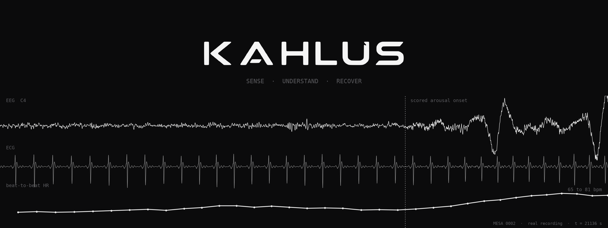
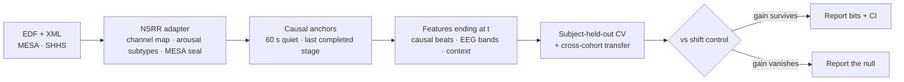

<div align="center">

<picture>
  <source media="(prefers-color-scheme: dark)" srcset="docs/assets/kahlus-wordmark-light.png">
  
</picture>

<p><strong>When <em>not</em> to stimulate a sleeping brain.</strong><br>
Arousal forecasting and a safety veto for closed-loop sleep stimulation, on NSRR polysomnography.</p>

[](https://github.com/Kahlus-Technologies/Kahlus-V2/actions/workflows/ci.yml)
[](pyproject.toml)
[](https://sleepdata.org)
[](#scope-and-safety)



<sub>One real night (MESA 0002). EEG arousal at the dashed line, heart rate climbs 65 → 81 bpm. Rendered by <code>scripts/make_readme_hero.py</code>.</sub>

</div>

---

## What this is

Closed-loop acoustic stimulation can deepen slow-wave sleep, but a click that lands just before a spontaneous arousal can wake the sleeper. Kahlus asks whether heart and EEG signals warn of those arousals early enough to hold the click back.

> **Success measure: wake-ups caused per 100 stimulations.**

How the work is kept honest:

- **Causal everything.** Features end at the prediction time. Beat detection, quality masks and normalizers only read the past, and tests check it.
- **Shift controls.** Every gain is compared against a time-shifted copy of the same features. If the shifted copy gains too, the model learned the person, not the signal.
- **Sealed test cohort.** SHHS-1 is for development. MESA is scored once, after the plan is frozen, through a guard in code ([`docs/results/mesa_exposure.md`](docs/results/mesa_exposure.md)).
- **Losses are results.** Nulls and negative results are reported.

## Results so far

> Every number below comes from a dev slice of 25 MESA + 25 SHHS nights with a smoke bootstrap. None of them is a claim until the full-cohort run.

| Study | Question | Where it stands |
| --- | --- | --- |
| [Heart-only arousal forecasting](docs/results/heart_arousal_forecast_dev_2026-11-05.md) | Does ECG predict a spontaneous arousal 5 to 120 s ahead, beyond time since the last arousal and sleep stage? | **Unresolved.** 5/20 cells above zero after review fixes. The sign moved with each fix. |
| [Beat-level warning](docs/results/heart_arousal_forecast_dev_2026-11-05.md) | Do the last 5 heartbeats warn 1 to 5 s ahead? | **Small and consistent.** 16/16 cells positive, 8 clear zero, about 1% of label entropy. |
| [Conformal alarm budget](docs/results/conformal_alarm_dev_2026-11-05.md) | Can a threshold guarantee a miss rate on new people? | **Works on average.** Per-person miss rate spreads from 0.07 to 0.36. |
| [Stimulation veto replay](docs/results/clas_replay_dev_2026-11-05.md) | Can a forecast hold back clicks that land right before an arousal? | **Yes, from context.** About 2× better than random. The heart adds a little, on SHHS only. |
| [Low-cost headband stress test](docs/results/montage_stress_dev_2026-11-05.md) | How much does dry-electrode noise cost arousal detection? | **About half.** Event F1 drops from 0.20–0.25 (clean) to 0.10–0.13 (dry headband). |

Data census: [`nsrr_arousal_census_2026-11-04.md`](docs/results/nsrr_arousal_census_2026-11-04.md). Roadmap: [`docs/ROADMAP.md`](docs/ROADMAP.md).

## Quickstart

```bash
git clone https://github.com/Kahlus-Technologies/Kahlus-V2.git && cd Kahlus-V2
python -m venv .venv && source .venv/bin/activate
pip install -e '.[dev]'
pytest
```

**Run the studies.** You need your own [sleepdata.org](https://sleepdata.org) access, with the token in `~/.nsrr_token`.

```bash
scripts/nsrr_fetch_slice.sh       # all MESA + SHHS-1 annotations and 25 EDFs each (~7 GB) into ~/data/nsrr
scripts/repro_dev_slice.sh        # every study into artifacts/runs/<time>-<commit>; see the header for settings
```

On a cluster, point `NSRR_ROOT` (or `NSRR_MESA_ROOT` / `NSRR_SHHS_ROOT`) at the full cohorts and set `JOBS` to run steps in parallel.

## How it works



| Piece | File |
| --- | --- |
| NSRR discovery, arousal subtypes, montage, MESA seal | `src/kahlus/nsrr.py` |
| Feature cache bound to data, ID list and commit | `src/kahlus/nsrr_cache.py` |
| Causal QRS detector and beat-quality mask | `src/kahlus/qrs_fast.py` |
| Anchors, labels, features, shift control, model | `src/kahlus/heart_arousal.py` |
| Residual forecastability (bits over baseline, subject bootstrap) | `src/kahlus/rfs.py` |
| Conformal alarms · stimulation replay · headband degradation | `src/kahlus/{conformal,clas_replay,montage_degrade}.py` |
| Study runners | `scripts/run_*.py` |
| Reproduce everything / prove a refactor changed nothing | `scripts/repro_dev_slice.sh` · `scripts/check_artifacts_unchanged.sh` |

## Scope and safety

- **Not a medical device.** This repo makes no clinical or diagnostic claims.
- **Dev-slice numbers are not claims.** A claim needs the full cohort, a claim-mode bootstrap (2,000 resamples) and multiplicity control.
- **No human stimulation** without engineering validation, informed consent, IRB approval and applicable regulatory review.
- **No raw data in git.** The repo holds code, configs, participant ID lists and aggregate JSON results. NSRR data requires your own credentialed access under the NSRR data use agreement.

## History

This project started inside [Kahlus-V1](https://github.com/Kahlus-Technologies/Kahlus-V1) (EEG neural-state forecasting, NeuroTwin). The sleep work was split out with its git history intact. Earlier findings and the v1 code stay there.

<div align="center">
<br>
<sub>Built by <a href="https://github.com/Kahlus-Technologies">Kahlus Technologies</a> · Aayushya Patel and Krish Garg</sub>
</div>
